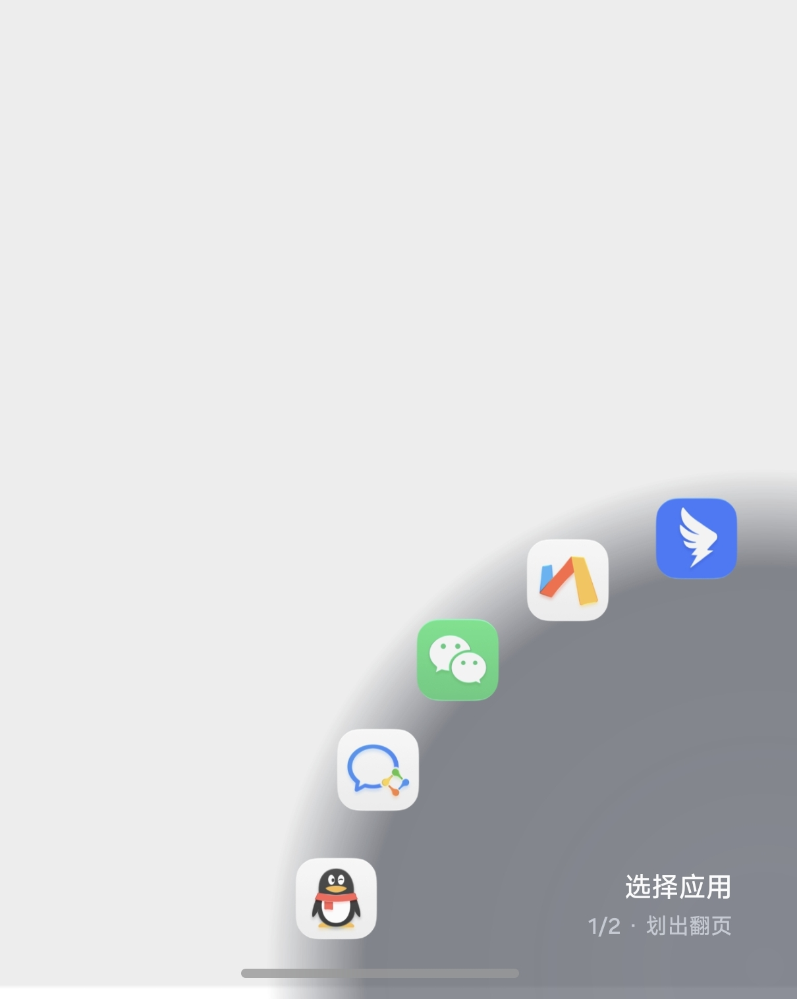

# 荣耀轻窗 HonorFreeform

从屏幕右下角向左上滑，唤出扇形「常用应用」小窗。为荣耀 MagicOS 11 的角落手势做的 LSPosed 模块，调用荣耀原生小窗接口，不接管窗口生命周期。

> 本地实验项目，定向适配一台机器。未在其它机型/固件验证；不保证全部应用都能进入小窗。

## 效果预览

<p align="center">
  
</p>

## 支持环境

| 项 | 要求 |
|---|---|
| 设备 | HONOR PTP-AN00（HNPLP） |
| 系统 | MagicOS 11.0.0，Android 17 / API 37 |
| 固件 | PTP-AN00 11.0.0.117(SP2C00E117R102P1) |
| 框架 | LSPosed（需支持 Android 17 的版本） |
| 作用域 | **仅 `com.android.systemui`** |

系统版本或固件不匹配时模块会自动拒绝启用，不会「尽力一试」。

## 使用

1. 在 LSPosed 中启用「荣耀轻窗」，作用域只勾选**系统界面（SystemUI）**。不要勾系统框架、桌面或全部应用。
2. 手动重启设备（模块不会自动重启或杀 SystemUI）。
3. 打开模块，点「检测连接与接口」，确认已注入。
4. 勾选常用应用（不限制总数，扇形每页 5 个，划出圆环外缘翻页，末页循环回首页）。
5. 主动开启「角落」，然后从右下角向左上滑，滑向应用松手启动；在角落区域松手取消。

菜单呼出期间有短时绘制浮层，松手取消即移除。屏幕关闭只收起当前菜单，保持开启；锁屏不会误触；切换用户会停用。

### 手势说明

接入的是荣耀原生底部手势，不创建常驻悬浮热区。竖屏右下角 36dp 起手区域从按下起预留给小窗——**该区域内普通上滑/点按也会被占用，其余区域保持原生**。首次测试建议暂时停用 mBack，避免手势冲突；仅支持系统手势导航。

## 已实现

- 受限的 LSPosed 宿主入口、能力探测与明确错误提示
- 轻量角落扇形面板：分页、圆形选中、长按试开、加入/移出常用、排序
- 普通公开桌面入口的小窗启动请求（只发请求，不劫持窗口）
- 与荣耀原生小窗接口协作：`HW_MULTI_WINDOWING_MODE_FREEFORM`(102) 与 `startActivityOneStep`，按运行值判定并检查应用资格后才调用

## 未实现 / 限制

- 不是 Flyme/SunOS 全套移植：无 WindowEngine、system_server Hook、SurfaceControl 生命周期、动画复刻
- 无下拉通知变小窗、白名单解锁、贴边挂起、独立 mini/pin 任务管理、多窗数量解锁、跨用户/双开、全局扇形输入捕获
- 没有可靠任务状态回调，提示只写「已请求」，不写「启动成功」
- 安全/锁屏/不支持调整大小的应用可能不可用；键盘、横竖屏、多窗口并存等表现由 MagicOS 决定
- 模块无网络权限；IPC 按 Android 34+ shared identity 校验真实 sender UID，只接受模块自身调用，仅允许 owner 主用户

## 回滚

长按侧边条，或设置页「立即关闭侧边入口」。SystemUI 异常时：LSPosed 中禁用模块后重启；若无法进入系统，按你所用的 Root/LSPosed 实现的安全模式处理（不同实现步骤不同，本包不提供猜测性的删文件/救砖命令）。

## 构建

JDK17 + Ubuntu aapt + R8 + apksigner，Java API 35：

```sh
python3 tools/fetch_dependencies.py
bash build.sh
```

## 许可与致谢

- 本项目按 GPL-3.0 分发，完整许可见 `LICENSE`
- 参考 [FanFreeform](https://github.com/oxohang/FanFreeform)（HyperOS 侧边小窗）与 [NativeComplements](https://github.com/AIXINJUELUOAI/NativeComplements)（Apache-2.0，扇形角度与手势阈值计算）
- 详细第三方归属见 `NOTICE.md` 与 `THIRD_PARTY_APACHE_2.0.txt`
